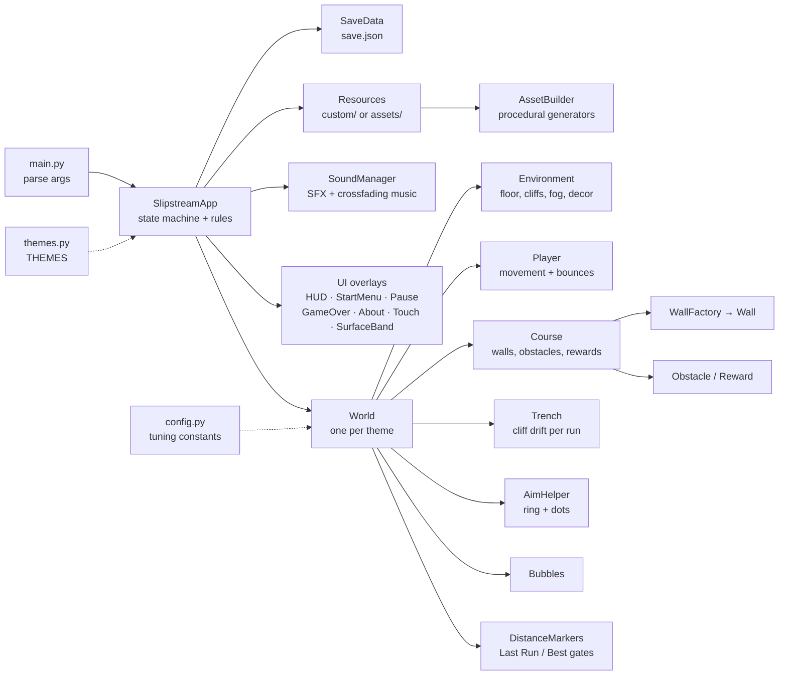
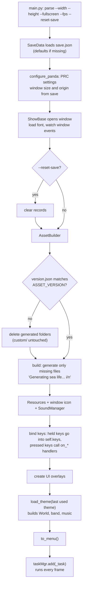
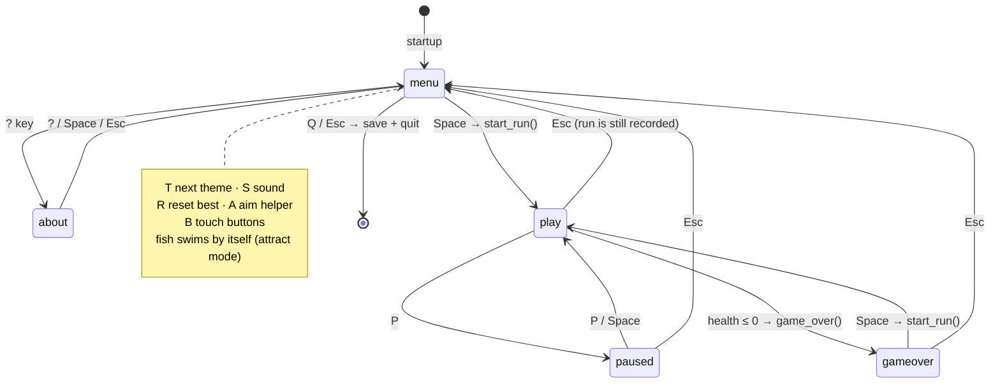
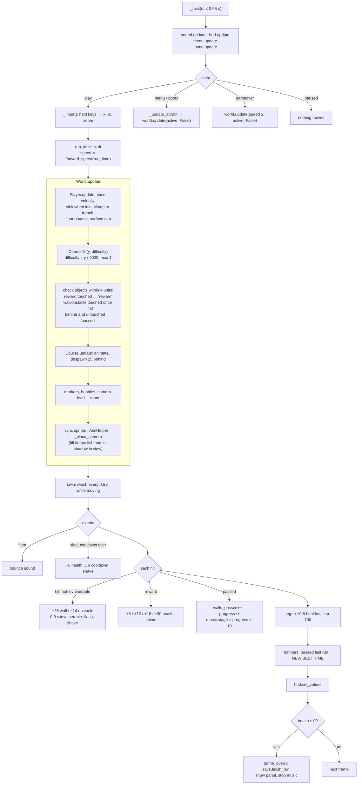
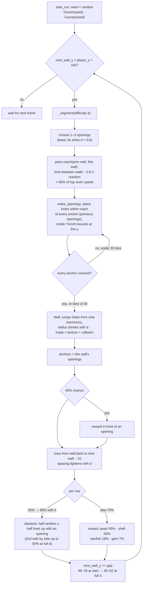
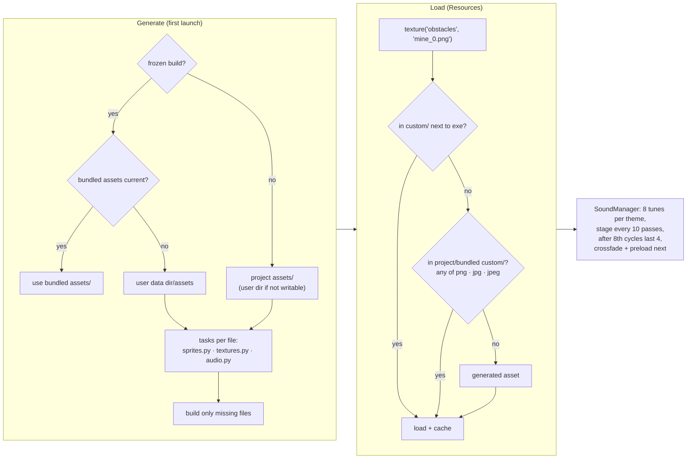

# How Slipstream runs

Six diagrams covering the whole game: who owns what, the startup path, the
state machine, one frame of play, how the endless course is generated, and how
art and sound are found. A formatted OpenDocument version with the same diagrams is in
[architecture.odt](architecture.odt)
(rebuild it with `python tools/build_docs.py`).

- [Module map](#module-map)
- [Startup](#startup)
- [Game states](#game-states)
- [One frame of play](#one-frame-of-play)
- [Course generation](#course-generation)
- [Assets and resources](#assets-and-resources)
- [Tuning numbers](#tuning-numbers)

## Module map

*`app.py`, `world/__init__.py`*

`SlipstreamApp` owns everything. It splits the game into a 3D half (`World`,
which moves things and reports collisions) and a rules half (the app itself,
which turns those reports into health, sounds, HUD updates and saved records).
`World` knows nothing about health or scoring.

## Startup

*`SlipstreamApp.__init__`*

The save file is read before Panda3D is imported, because the last window size
must be set before the window opens. Missing assets are generated next, with a
progress message rendered frame by frame.

## Game states

*`self.state`*

The app is a five-state machine. Key events call `on_*` methods that check the
current state before acting; `_task` then advances whichever state is active
each frame.

- **menu / about:** `_update_attract` fakes key presses from slow sine waves so
  the fish weaves through open water.
- **play:** `_update_play` runs the rules (next diagram).
- **paused:** the world is not updated at all, so it stays frozen.
- **gameover:** the fish drifts forward at speed 2 with `active=False` (no
  collisions) behind the panel.

## One frame of play

*`_task` → `_update_play` → `World.update`*

Each frame, `dt` is capped at 1/20 s so a stall can't push the fish through a
wall in one step. The world moves everything and returns two lists: **events**
(bumped the floor or a cliff) and **hits** (hit, reward or passed). The app
turns those into game consequences.

- **One hit per object.** Each wall or obstacle sets `hit = True` on first
  contact, and the 0.9 s invulnerability window stops brushing along a wall
  from costing several hits.
- **Score is time survived.** `run_time` is the score; the fish's `y` is the
  distance used for the Last Run and Best gates.
- **Wall collision is pixel exact.** A wall's hole mask is also its texture
  alpha; the fish's centre and 8 rim points are tested against it.

## Course generation

*`course.py`, `walls.py`, `pace.py`, `trench.py`*

The course is endless but fully determined by one random seed per run. It is
built one **segment** at a time (a wall, then rows of obstacles up to the next
wall) whenever the next wall comes within 165 units. The key guarantee: every
wall has an opening the player can reach in time from some opening of the
previous wall.

- **Speed.** Forward speed rises from 9 toward 19 units/s on an exponential
  curve (time constant 150 s). `time_at(y)` inverts the distance integral by
  bisection so generation knows how long the player has between walls.
- **Trench.** Each cliff drifts inward by up to 9.6 units using three long sine
  waves with random phases, clipped and faded in after the first 25 units.

## Assets and resources

*`assetgen/`, `resources.py`, `sound.py`*

Nothing binary ships in the repo. Generators draw every sprite, texture, effect
and tune with numpy and Pillow. At load time, files in `custom/` always win
over generated ones.

## Tuning numbers

*`config.py`*

| Constant | Value | What it controls |
|---|---|---|
| `HEALTH_MAX` | 100 | Run ends at 0 |
| `WALL_DAMAGE` / `OBSTACLE_DAMAGE` | 25 / 14 | Health lost per hit |
| `CLIFF_DAMAGE` | 5 per 1 s | Scraping or being pushed by a side cliff |
| `HIT_INVULNERABLE` | 0.9 s | Grace period after a hit |
| `HEALTH_REGEN` | 0.6 /s | Slow natural healing |
| `FORWARD_SPEED_START` → `MAX` | 9 → 19 | Units/s, ramp constant 150 s |
| `DIFFICULTY_DISTANCE` | 4000 | Distance at which difficulty reaches 1 |
| `SPAWN_AHEAD` / `DESPAWN_BEHIND` | 165 / 25 | Course window around the fish |
| `MUSIC_STAGE_EVERY` | 10 | Walls and obstacles passed per tune change |
| `CAM_DIST_MIN` – `MAX` | 3 – 18 | A / Z zoom range |

Drawn from the source at commit ff32eb0. The diagrams simplify some detail; the
code is the reference.
